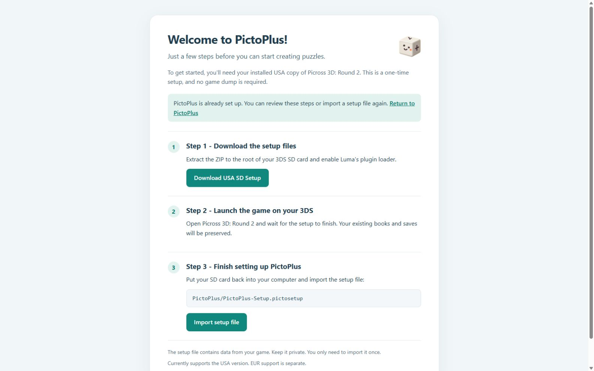

<p align="center"></p>

# PictoPlus

**A puzzle creator for Picross 3D: Round 2.**

Build something out of blocks, turn it into a puzzle, and play it on your 3DS. PictoPlus brings the designer, puzzle books and export tools together in one Windows app.


## Make something of your own

- Draw with blue cubes and yellow shapes, working freely or one layer at a time.
- Preview the puzzle's numbers and adjust Easy, Medium and Hard separately.
- Organise puzzles into books with custom names, artwork and covers.
- Import a 3D model as an experimental starting point, or attach one for the final reveal.
- Share a `.pictobook` file that other players can play or open in PictoPlus to edit.

The converter is still experimental. Small details and complex shapes often need some hand editing. Preview the result before exporting.

## Download PictoPlus

[Download PictoPlus for Windows](https://github.com/KodakWizard/PictoPlus/releases/latest/download/PictoPlus-Windows-USA.zip) · [All downloads](https://github.com/KodakWizard/PictoPlus/releases/latest)

New here? Start with the Windows app and follow its welcome steps. Already set up? The release also includes the USA loader update and an optional [Animals pack with 15 puzzles](https://github.com/KodakWizard/PictoPlus/releases/latest/download/PictoPlus-Animals-Puzzle-Pack.zip).

## What you'll need

- Windows 10 22H2 or Windows 11, 64-bit.
- A supported, installed **USA** copy of Picross 3D: Round 2.
- A 3DS with Luma3DS and its plugin loader enabled, plus access to the SD card.
- Microsoft WebView2. If it is missing, PictoPlus offers the official Microsoft installer, which needs an internet connection.

Python and the compiler helpers are included. The normal 3DS setup does **not** require a ROM dump, Checkpoint restore or manual save editing.

USA is the supported public package. EUR work is kept separate and is not included in the USA download. Do not mix regional loaders. Hardware testing has included a New 3DS LL with Luma 13.4; this is not a claim that every console, game update or custom firmware combination has been tested.

## First-time setup

1. Download `PictoPlus-Windows-USA.zip` from this repository's Releases page. Extract the **whole ZIP** to a writable folder and open `PictoPlus.exe`.
2. Choose **Download USA SD Setup**. Extract it to the root of your 3DS SD card and enable Luma's plugin loader.
3. Launch your installed USA game and let PictoPlus finish preparing the setup file.
4. Put the SD card back into your computer. Choose **Import setup file** in PictoPlus and select `PictoPlus/PictoPlus-Setup.pictosetup`.

That's the one-time setup. Your existing books and saves stay in place. The setup file contains data from your game, so **keep it private**.



## From a book to your 3DS

Start with **My Book**, or create a new book and add your puzzles. In **Book Library**, select the books you want to play and choose **Export / install**.

Copy the exported `.pictobook` files to:

```text
SD:/PictoPlus/Books/
```

Extract multi-book ZIPs before copying them. Put the card back into your 3DS and launch the game. New or updated books are prepared once; unchanged books use the existing cache.

Keep the registry and progress files when adding books or updating the loader. Each book supports up to **210 puzzles**. The current loader has **71 persistent custom-book slots**; deleting a book preserves its slot and progress rather than making that identity available for a different book.

For Azahar, books use `PictoPlus/Books/` on the emulator's virtual SD card, with the matching USA loader installed. See [installation](docs/INSTALLATION.md) for paths and the separate emulation notes.

## Share your books

Share the `.pictobook` file. Other PictoPlus users can copy it to their Books folder to play, or import it into the app to edit.

Only include models and artwork you have permission to share. Don't upload your setup file, extracted game resources, saves or registry files.

## Need a hand?

Start with [installation](docs/INSTALLATION.md) and [troubleshooting](docs/TROUBLESHOOTING.md). For a bug report, include the app version, your game region, what you were doing and the relevant log. Please remove personal information first. Never attach a ROM or a setup file to a public issue.

Code, documentation and testing contributions are welcome. [CONTRIBUTING.md](CONTRIBUTING.md) explains the build and test workflow. [CHANGELOG.md](CHANGELOG.md) records the release changes.

## A note on AI

PictoPlus was developed over the course of a month, with countless hours spent building, refining, debugging and testing it.

AI-assisted coding tools have been a big part of the development process, but this wasn't something that came together with a single prompt. There's been a lot of back and forth, plenty of experimentation, more than a few things breaking, and many rounds of testing to get everything working.

I wanted to be transparent about how it was made, while also acknowledging the time, care and hands-on work that went into it.

## Licence and acknowledgements

PictoPlus's original code is available under the [MIT licence](LICENSE). Dependencies retain their own licences; see [third-party and artwork notices](docs/ASSETS-AND-LICENCES.md). The cube mascot was generated with ChatGPT, and the built-in covers were made with image-generation tools. This does not mean that AI-generated artwork is guaranteed to be copyright-free or legally cleared.

PictoPlus is an unofficial fan project. It is not affiliated with, sponsored by or endorsed by Nintendo. Nintendo and Picross 3D: Round 2 names and trademarks belong to their respective owners. You need your own legitimate copy of the game; no game assets or ROMs are supplied.
