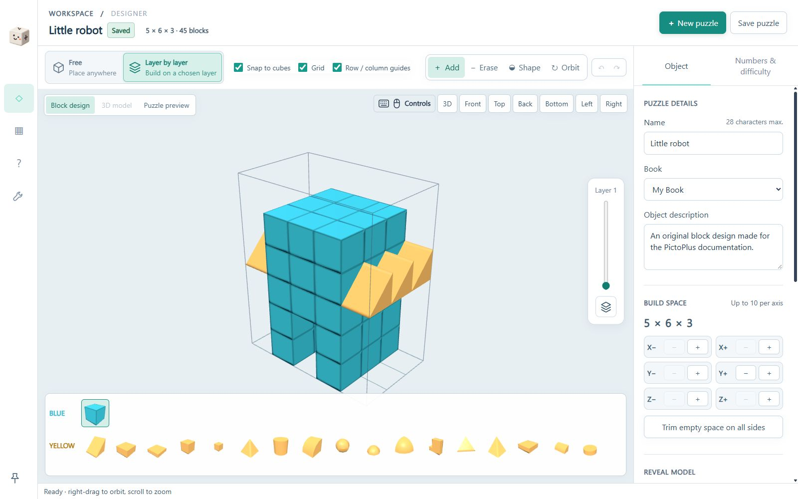
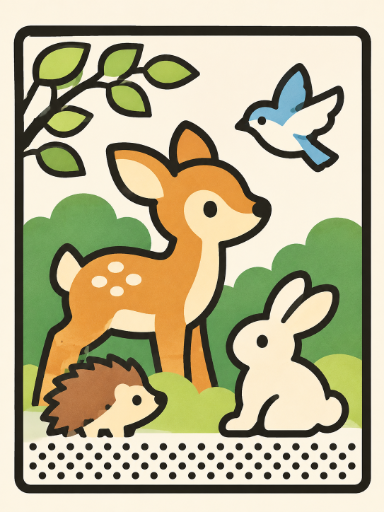

# PictoPlus

**Make your own puzzles for Picross 3D: Round 2.**

Build something from blue cubes and yellow shapes, turn it into a puzzle, and see if a friend can solve it. PictoPlus lets you design puzzles, collect them in books, and play them on your 3DS.

**v0.9 Beta** · [Windows app](https://github.com/KodakWizard/PictoPlus/releases/download/v0.9.0/PictoPlus-Windows-USA.zip) · [USA SD loader](https://github.com/KodakWizard/PictoPlus/releases/download/v0.9.0/PictoPlus-USA-SD-Loader.zip) · [Release notes](https://github.com/KodakWizard/PictoPlus/releases/tag/v0.9.0)

## Start with a few blocks

Draw one layer at a time or work freely in 3D. Preview the clues, choose how tricky to make the puzzle, and give your book a cover. You can also try importing a 3D model or attaching one as the final reveal. Model conversion is experimental, so take a look at the blocks before exporting.

## Get it onto your 3DS

Extract the whole Windows ZIP and open **PictoPlus.exe**. Copy the SD loader’s `luma` and `PictoPlus` folders to the root of your SD card. Launch the installed USA game with Luma’s plugin loader enabled. If a setup file is missing, the loader creates it from your game. In the Windows app, choose **Import an existing setup file** and select it from the SD card. Keep that file private.

In **Book Library**, select a book and choose **Export / install**. Copy the exported `.pictobook` to `SD:/PictoPlus/Books/`. You can share that same file with a friend to play or edit.

The public loader supports the **USA** game. EUR work is separate. For Windows requirements, upgrades and the optional setup markers, see the [installation guide](docs/INSTALLATION.md). If you get stuck, start with [troubleshooting](docs/TROUBLESHOOTING.md).

## A book to try

The optional **Animals Puzzle Pack** has 15 puzzles, from a hummingbird to a hippopotamus. Unzip it and copy `Animals.pictobook` to your Books folder. If you already have Animals, replace the older file. The download includes the model credits and CC BY 3.0 licence details. [Download the Animals pack](https://github.com/KodakWizard/PictoPlus/releases/download/v0.9.0/PictoPlus-Animals-Puzzle-Pack.zip)

[Changelog](CHANGELOG.md) · [Contributing](CONTRIBUTING.md) · [Previous v0.8 Alpha](https://github.com/KodakWizard/PictoPlus/releases/tag/v0.8.0)

## A note on AI

PictoPlus was developed over the course of a month, with countless hours spent building, refining, debugging and testing it.

AI-assisted coding tools have been a big part of the development process, but this wasn't something that came together with a single prompt. There's been a lot of back and forth, plenty of experimentation, more than a few things breaking, and many rounds of testing to get everything working.

I wanted to be transparent about how it was made, while also acknowledging the time, care and hands-on work that went into it.

## Licence and acknowledgements

PictoPlus's original code is available under the [MIT licence](LICENSE). Dependencies retain their own licences. See [third-party and artwork notices](docs/ASSETS-AND-LICENCES.md). The cube mascot was generated with ChatGPT, and the built-in covers were made with image-generation tools. This does not mean that AI-generated artwork is guaranteed to be copyright-free or legally cleared.

PictoPlus is an unofficial fan project. It is not affiliated with, sponsored by or endorsed by Nintendo. Nintendo and Picross 3D: Round 2 names and trademarks belong to their respective owners. Play with your own legitimate copy of the game. The downloads contain PictoPlus and its redistributable dependencies.
