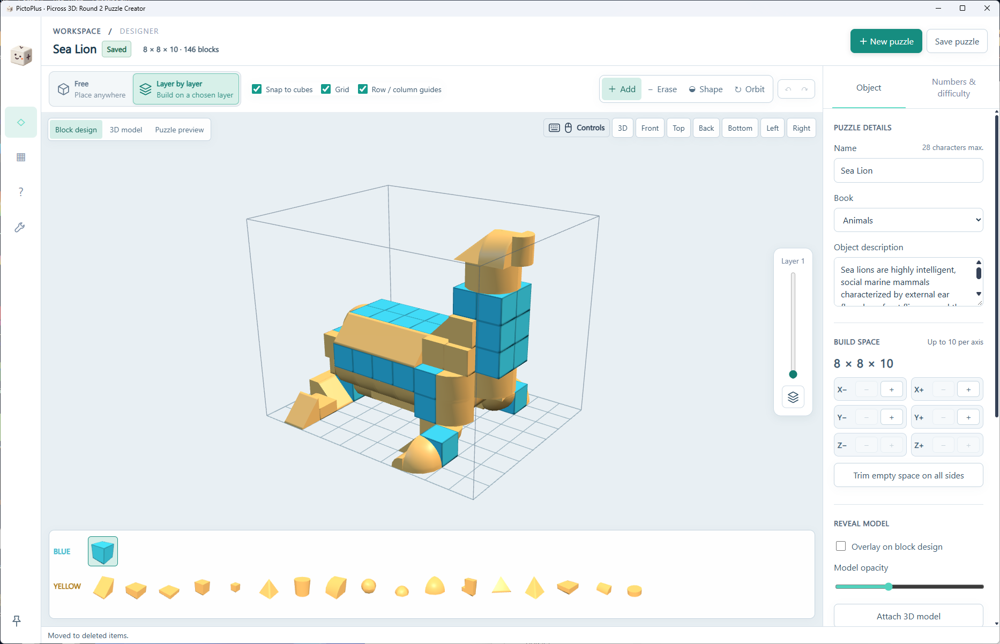
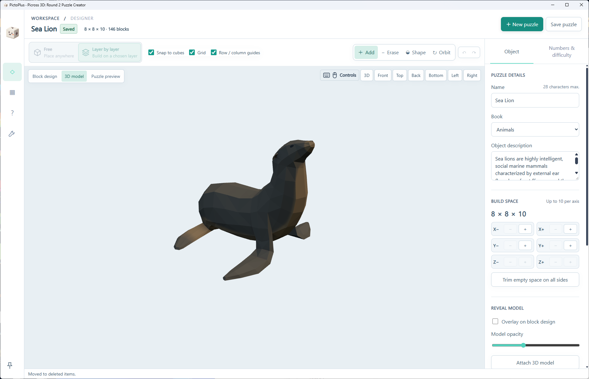
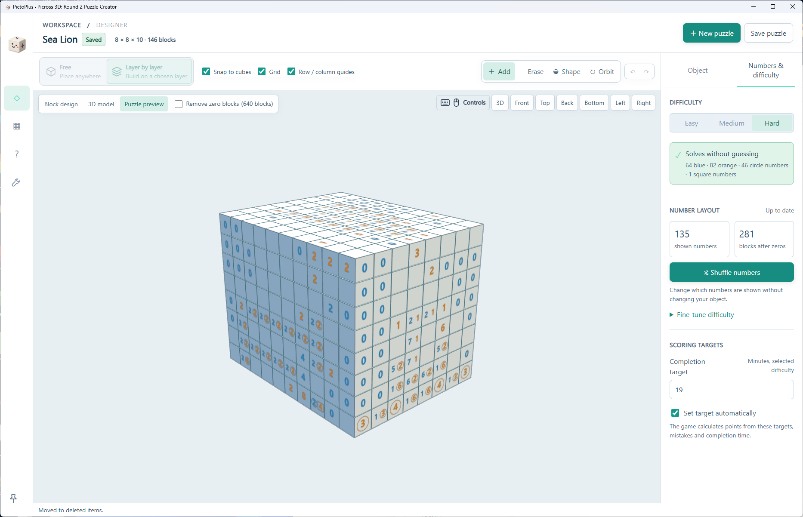
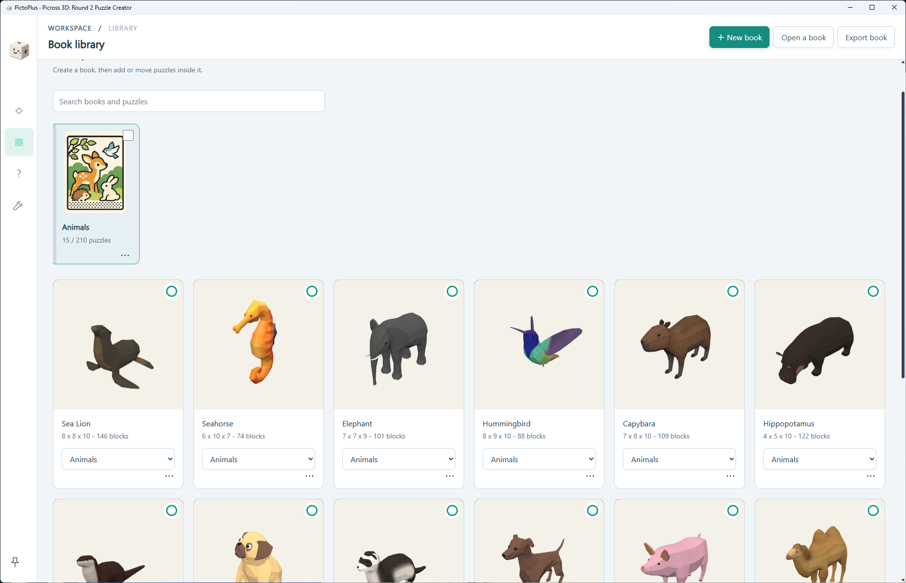
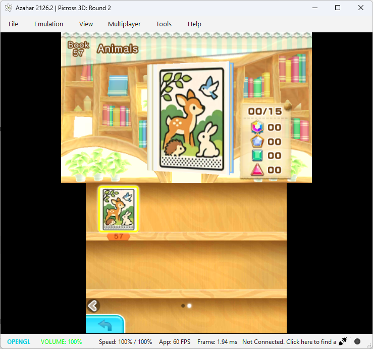
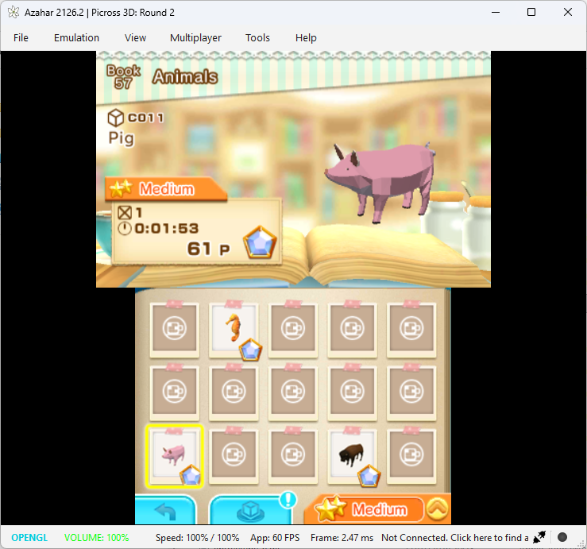
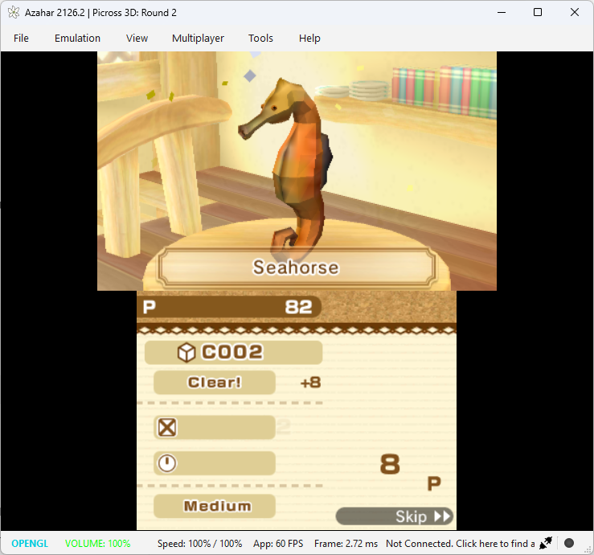
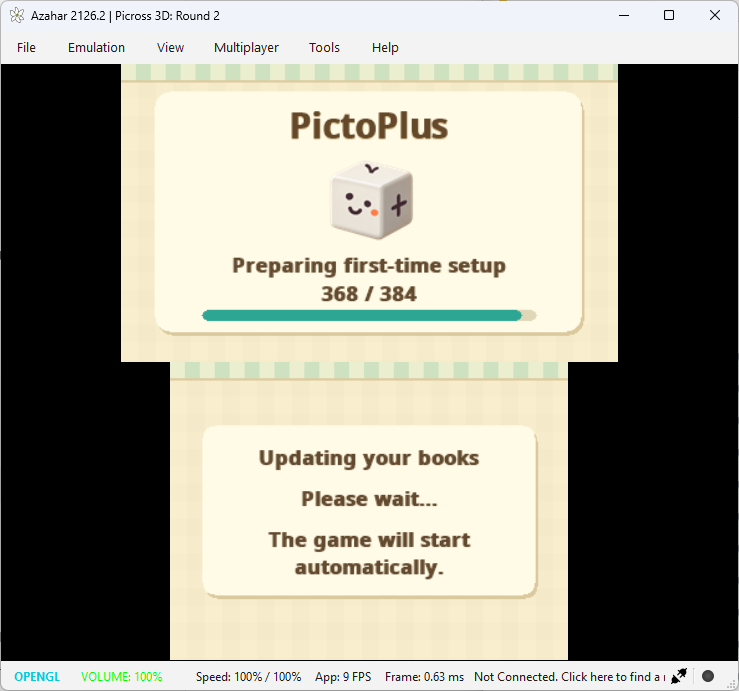

  

<h1 align="center">PictoPlus</h1>

  <strong>Make your own puzzles for Picross 3D: Round 2.</strong>

Ever wished Picross 3D: Round 2 had more puzzles to play?

PictoPlus lets you create your own 3D puzzles, collect them into books and play them on your Nintendo 3DS or with Azahar. Build something from scratch, experiment with 3D models, and share your creations with friends.

It's a little fan-made project for anyone who loves the game and wants to keep creating.

  <strong>v1.0.0</strong>

  <a href="https://github.com/KodakWizard/PictoPlus/releases/download/v1.0.0/PictoPlus-Windows.zip"><strong>Download for Windows</strong></a>
  &nbsp;·&nbsp;
  <a href="https://github.com/KodakWizard/PictoPlus/releases/download/v1.0.0/PictoPlus-SD-Loader.zip"><strong>USA + EUR SD Loader</strong></a>
  &nbsp;·&nbsp;
  <a href="https://github.com/KodakWizard/PictoPlus/releases/tag/v1.0.0">Release notes</a>

## A look inside PictoPlus

<table>
  <tr>
    <td width="50%" align="center">
      
      Build your own 3D puzzles
    </td>
    <td width="50%" align="center">
      
      Preview the finished model
    </td>
  </tr>
  <tr>
    <td width="50%" align="center">
      
      Fine-tune your puzzle's difficulty
    </td>
    <td width="50%" align="center">
      
      Collect puzzles into your own books
    </td>
  </tr>
</table>

## Features

- **Create your own 3D puzzles** - Build with blue cubes and yellow shapes, working freely in 3D or one layer at a time.
- **Import 3D models** - Turn existing models into puzzles or attach them as the finished reveal. Conversion is still experimental, so some manual editing may be needed.
- **Make puzzles as easy or tricky as you like** - Preview and fine-tune clues for Easy, Medium and Hard, with tools to check whether your puzzle can be solved without guessing.
- **Build your own puzzle books** - Organise up to 210 puzzles per book, with custom covers, artwork, names and descriptions.
- **Play on your 3DS or PC** - Export your creations and play them in Picross 3D: Round 2 using a Nintendo 3DS or the Azahar emulator.
- **Share your creations** - Send `.pictobook` files to friends so they can play your puzzles or open them in PictoPlus to edit.
- **Keep your progress** - The loader saves your progress and avoids rebuilding books that haven't changed.

## See it running in-game

Your custom puzzles become part of Picross 3D: Round 2, complete with their own books, artwork and finished 3D models.

These screenshots were captured using Azahar with the PictoPlus USA loader.

<table>
  <tr>
    <td width="50%" align="center">
      
      Your own books in the game
    </td>
    <td width="50%" align="center">
      
      Browse and play your puzzles
    </td>
  </tr>
  <tr>
    <td width="50%" align="center">
      
      See your creations come to life
    </td>
    <td width="50%" align="center">
      
      PictoPlus preparing your setup
    </td>
  </tr>
</table>

## Getting started

You'll need:

- A Windows 10 (22H2 or newer) or Windows 11 PC, 64-bit.
- A Nintendo 3DS with Luma3DS, or the Azahar emulator.
- A personal **USA/EUR copy of Picross 3D: Round 2.**

PictoPlus v1.0.0 supports the USA and EUR game revisions only. EUR physical 3DS testing is pending.

### 1. Download the Windows app

Download [PictoPlus for Windows](https://github.com/KodakWizard/PictoPlus/releases/download/v1.0.0/PictoPlus-Windows.zip).

Extract the entire ZIP to a folder on your computer and open `PictoPlus.exe`.

Keep all the included files together. PictoPlus needs them to run correctly.

### 2. Install the USA + EUR SD Loader

Download the [PictoPlus USA + EUR SD Loader](https://github.com/KodakWizard/PictoPlus/releases/download/v1.0.0/PictoPlus-SD-Loader.zip).

Extract its `luma` and `PictoPlus` folders to the root of your 3DS SD card, keeping the original folder structure.

**Enable plugin loading in Luma3DS:**

1. Turn on your 3DS and open the Rosalina menu by pressing `L + D-Pad Down + Select`.
2. Find **Plugin Loader** and set it to **Enabled**.
3. Press `B` to exit the menu.

Now launch your personal USA or EUR copy of Picross 3D: Round 2. The ZIP puts each plugin in its own title folder so Luma3DS can load the right one automatically.

### 3. Complete the one-time setup

On first launch, PictoPlus can prepare a setup file using your installed game.

Once it's finished, return the SD card to your computer and import this file into the Windows app:

`SD:/PictoPlus/PictoPlus-Setup.pictosetup`

You only need to do this once.

**Already used PictoPlus before?** You can import an existing valid setup file instead. There's no need to generate it again. If you're reinstalling the loader and want to skip generation, the SD package includes an optional skip file. See the [installation guide](docs/INSTALLATION.md).

Keep your setup file private. It contains resources from your game and should never be shared.

No ROM dump or manual save editing is needed for the normal physical 3DS setup.

### 4. Create and play!

Open PictoPlus and start making puzzles.

Once you've created a book, go to **Book Library**, select it and choose **Export / install**.

Copy the exported `.pictobook` file to:

`SD:/PictoPlus/Books/`

Put your SD card back into your 3DS, launch the game and enjoy your creations!

You only need to install the loader once. You can add more books whenever you like.

## Playing on Azahar

Prefer playing on your PC? PictoPlus also works with [Azahar](https://www.azahar-emu.org/), the Nintendo 3DS emulator.

Both USA and EUR booted with the loader in Azahar. USA gameplay was also previously tested on a physical 3DS.

You'll need your personal **USA or EUR copy of Picross 3D: Round 2.**

### Setup

1. Open Azahar and go to **Emulation → Configure → System**.
2. Enable **3GX Plugin Loader**.
3. Go to **File → Open Azahar Folder** and locate the `sdmc` folder.
4. Extract the [PictoPlus USA + EUR SD Loader](https://github.com/KodakWizard/PictoPlus/releases/download/v1.0.0/PictoPlus-SD-Loader.zip) into `sdmc`, keeping its folder structure intact.
5. Copy your `.pictobook` files into `sdmc/PictoPlus/Books/`.
6. Launch your USA or EUR copy of Picross 3D: Round 2.

**Using portable Azahar?** Your virtual SD card may be located at:

`Azahar/user/sdmc/`

The exact location depends on your installation, so using **File → Open Azahar Folder** is the easiest way to find it.

You don't need Luma3DS installed inside Azahar. The emulator has its own 3GX plugin loader.

Compatibility may vary between emulator versions. On Windows, keep portable Azahar in a short folder path so the emulator can create the game save folders.

## A book to get you started

  

Not sure where to start? I've put together an **Animals Puzzle Pack** with 15 puzzles, featuring everything from a hummingbird to a hippopotamus.

It's a nice way to try PictoPlus without having to make your own puzzles first.

**[Download the Animals Puzzle Pack](https://github.com/KodakWizard/PictoPlus/releases/download/v1.0.0/PictoPlus-Animals-Puzzle-Pack.zip)**

Just unzip the download and copy `Animals.pictobook` into your `PictoPlus/Books/` folder on your 3DS or Azahar virtual SD card.

If you already have an older version of Animals, replace it with the new one.

The pack includes model credits and CC BY 3.0 licence information. Please keep these credits if you redistribute the pack.

## Sharing your creations

Made something you're proud of?

Share your `.pictobook` file with another PictoPlus user. They can copy it to their Books folder to play, or import it into the desktop app to make their own changes.

**Want to share your puzzles with the community?**

Head over to [Puzzle Book Submissions](https://github.com/KodakWizard/PictoPlus/discussions/categories/puzzle-book-submissions) on GitHub Discussions.

1. Create a new discussion with the name of your puzzle book.
2. Attach a ZIP containing your `.pictobook` file.
3. Add a short description and some screenshots if you have any.

Feel free to try other people's puzzles and leave feedback!

Please only share models and artwork you have permission to distribute.

Your setup files, extracted game resources and save data should stay private.

## Help & contributing

Earlier releases remain available in [GitHub Releases](https://github.com/KodakWizard/PictoPlus/releases).

If something isn't working or you have an idea for a new feature, feel free to [open an issue](https://github.com/KodakWizard/PictoPlus/issues).

Bug reports, suggestions and code contributions are all welcome!

You can also find more information here:

- [Full installation guide](docs/INSTALLATION.md)
- [Troubleshooting](docs/TROUBLESHOOTING.md)
- [Contributing](CONTRIBUTING.md)
- [Changelog](CHANGELOG.md)

## A note on AI

PictoPlus was developed over the course of a month, with countless hours spent building, refining, debugging and testing it.

AI-assisted coding tools have been a big part of the development process, but this wasn't something that came together with a single prompt. There's been a lot of back and forth, plenty of experimentation, more than a few things breaking, and many rounds of testing to get everything working.

I wanted to be transparent about how it was made, while also acknowledging the time, care and hands-on work that went into it.

## Licence and acknowledgements

PictoPlus's original code is available under the [MIT licence](LICENSE). Third-party dependencies retain their own licences. See [third-party and artwork notices](docs/ASSETS-AND-LICENCES.md).

The cube mascot was generated with ChatGPT, and the built-in covers were made using image-generation tools. AI-generated artwork is not automatically guaranteed to be copyright-free or legally cleared.

PictoPlus is an unofficial fan project and is not affiliated with, sponsored by or endorsed by Nintendo. Nintendo and Picross 3D: Round 2 names and trademarks belong to their respective owners.

**PictoPlus requires a legally obtained copy of Picross 3D: Round 2.** No Nintendo game files, ROMs or proprietary game assets are included in the downloads.
